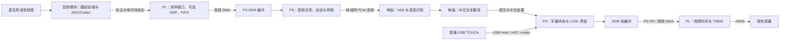

# 同声传译产品详细方案

日期：2026-10-10。本文是设计方案，不是完成记录。硬件事实以 [MAP](../context/MAP.md) 为准，已确认选择以 [DECISIONS](../context/DECISIONS.md) 为准，执行进展以 [NOW](../context/NOW.md) 为准。

2026-10-14 范围更新：最终产品改为板卡通过 Wi-Fi 直接调用阿里百炼云端语音翻译，电脑仅用于开发调试。当前云端结构、选型与接入阶段唯一由 [CLOUD_SPEECH](CLOUD_SPEECH.md)维护；本文保留早期局域网、Linux/LVGL 等建议供追溯，不把其旧路线当作当前已确认方案。

## 1. 第一版产品定义

第一版做“持续监听外语、显示中文字幕”的桌面终端：音频模块接板卡扩展 I/O，屏幕通过 HDMI 显示，通过 USB TOUCH 控制开始、暂停、查看记录与设置。语音识别和翻译由局域网电脑处理。中文语音播报不属于当前必做范围；“同声”在这里表示连续采样、逐段更新字幕，不表示零延迟或专业口译质量已经达成。

建议第一版只验证一种固定源语言到简体中文，减少自动语种识别造成的等待与误判。主要源语言尚未确认，原型先使用英语演示文案；不由此承诺多语种模型支持。

最小可用功能：开始/暂停、清晰的采集与后端状态、当前中文译文、可选原文、最终会话记录、字号设置、无音频/断线/过载反馈。高级降噪、自动语言检测、说话人分离、语音合成、云端账号和多设备同步放到后续独立需求。

## 2. 系统总体分工

这是推荐结构；实际模块、驱动和接口必须逐阶段验收。若音频模块自带数字麦克风而没有独立 ADC，AFE 是模块内部功能；若只有模拟输出，需要补 ADC/Codec，不能把模拟电压当作 PL 可直接接收的音频协议。

| 部分 | 第一版职责 | 输出与验证重点 |
|---|---|---|
| 音频硬件 | 输入匹配、偏置/放大、模拟抗混叠、ADC | 模块数据手册、供电与有效数字样本 |
| PL 音频链路 | 接口时序、通道选取、位宽转换、跨时钟 FIFO、溢出统计 | 样本顺序、采样率、幅度、DMA 连续性 |
| PL 可选前处理 | 去直流、明确依据的滤波、必要重采样；先旁路 | 与旁路对比的可回放样本，不能只看波形“更平滑” |
| PS 应用 | 会话、网络、UI、USB 输入、设备状态 | 界面始终响应，音频/网络任务不阻塞渲染 |
| 局域网电脑 | 断句/VAD、ASR、中文翻译、结果修订 | 识别质量、翻译质量、吞吐与端到端时延 |
| PL 视频链路 | 从 DDR 读像素，稳定输出现有 HDMI 模式 | 中文显示、刷新、无撕裂、读出不欠载 |

FPGA 适合规则的采样时序与 DSP，并不天然完成“声音理解和翻译”。本方案将模型放在电脑，是基于已选后端和板上资源的工程判断。AMD 资料中 Z-7010 为双核 Cortex-A9、约 28K 逻辑单元、2.1 Mb BRAM、80 个 DSP；这些资源适合终端职责，完整多语种模型是否能在板上实时运行不能无验证承诺。[AMD 产品表](https://www.amd.com/en/products/adaptive-socs-and-fpgas/soc/zynq-7000.html)

## 3. PS 系统与开发方式建议

### 推荐：PS Linux + 原生 LVGL

Linux 提供网络、USB Host/HID、输入事件和应用调试基础；LVGL 在 PS 上渲染界面，PL 负责送屏。Zynq-7010 没有可供此方案依赖的现代 GPU，使用 CPU 软件渲染，界面以文字和小范围动画为主。LVGL 上游提供 fbdev、DRM/KMS 与 evdev 接口；它们仍要求板上先有真正可用的显示和输入驱动。[LVGL Linux 文档](https://lvgl.io/docs/open/integration/embedded_linux)

Windows 保留 VS Code、Vivado 和脚本入口。LVGL/板端 C/C++ 用 CMake + Ninja 和交叉工具链；PL 构建用 Vivado Tcl；PS 应用通过 GDB/SSH 调试，PL 必要时手动实例化 ILA。Linux 镜像构建选择厂商 RevB BSP 与其支持的 Linux 构建环境，不因为已有 Windows Vivado 就认为 Linux 环境已具备。

PetaLinux 2026.1 文档仍列出 Zynq-7000 支持，并注明计划在 2026.2 弃用该工具集，因此不能只按“最新版”选长期构建路线。2026.1 要求同版本 Vivado 导出，且使用支持的 Linux 构建主机；现有资料库教程名称为 PetaLinux 2018.3，需要先评估同板可用基线和迁移代价，不能直接混装旧 BSP 与新 XSA。[AMD UG1144](https://docs.amd.com/r/en-US/ug1144-petalinux-tools-reference-guide/Introduction)、[安装要求](https://docs.amd.com/r/en-US/ug1144-petalinux-tools-reference-guide/Installation-Requirements)

### 与之前裸机/FreeRTOS 路线的关系

裸机/FreeRTOS 仍可用于独立 PS/DDR/显示 bring-up，或在极简产品中承担界面和 lwIP 网络。但当前增加 USB 触摸 Host、HID 解析、热插拔、网络恢复与文本界面，裸机路线需要先证明这些栈可用并补相应工程量。不是禁止裸机，而是不把“USB 控制器存在”当成“触摸 Host 软件已经齐全”。

建议以 Linux 为产品软件主线；如果资料和构建环境不满足，再单独比较 FreeRTOS 代价。该建议尚未作为已确认技术决策，也未安装任何环境。

## 4. HDMI 中文 UI 如何真正上板

已有工程验证了视频时序和 TMDS，但其像素来自 PL 图案逻辑。中文文字、滚动记录和按钮不能仅修改彩条颜色实现，需要可更新的像素或字形来源。

推荐显示链路：`PS 渲染 → DDR 双缓冲 → PS HP AXI → AXI VDMA MM2S → 像素解包/FIFO → 光栅与 TMDS → 屏幕`。AXI VDMA 的读通道将系统内存中的帧转为 AXI4-Stream；还要完成视频时序适配，不能将 DMA 输出直接当成 TMDS。[AMD PG020](https://docs.amd.com/r/en-US/pg020_axi_vdma/Overview)

实施顺序：先显示 CPU 写入的纯色与棋盘格，确认 stride、像素格式和地址；再显示固定中文；再接 LVGL 与模拟字幕；最后接触摸和网络。沿用已经验收的板卡时序和约束，映射见 MAP，不同时更换分辨率。

显示驱动有两个候选：优先评估可匹配此 PL 扫描链路的 DRM/KMS 驱动；若同板 BSP 仅有可靠 fbdev，可先用它完成 bring-up。AXI VDMA 的 DMA 驱动本身不自动生成 `/dev/fb0` 或 DRM 显示设备；要确认或实现扫描输出、内存映射、模式设置和翻页支持。当前没有声称这些驱动已存在。

缓存与翻页要点：使用 DMA 可访问且由驱动管理的连续/映射内存，正确处理 CPU Cache；明确 RGB565 或 XRGB8888、行 stride 和字节顺序；只在安全帧边界切换前后缓冲。欠载时保留最后有效帧或显示受控底色，并累计计数。不要用随意固定的物理地址或长期开 `/dev/mem` 代替驱动设计。

中文由 PS 字体系统绘制。原型使用电脑系统字体，不能据此推断板端字库已具备；正式 LVGL 应验证简体中文、英文、数字、标点、罕见字替代和长句换行，记录字体来源及内存开销。

## 5. 音频接入与前处理设计

模块未确认时只定义需求，不锁定引脚。优先希望取得标准数字音频（如 I2S），所需信号通常为 BCLK、LRCLK、数据输入、可能的 MCLK 和配置总线；实际数量、主从关系、有效沿、位宽与槽宽以模块资料为准。

| 模块接口情况 | 对应设计 |
|---|---|
| I2S ADC/Codec | 按模块时序采样；只允许一个 BCLK/LRCLK 驱动者；需要时配置 I2C/SPI |
| PDM 数字麦克风 | 先完成 PDM 时钟与抽取滤波，得到 PCM，再送后续链路 |
| SPI ADC | 依据采样速率和帧协议规划 SPI，不能套用 I2S RTL |
| 只有模拟麦克风/线路输出 | 加适当模拟前端和 ADC/Codec；PL I/O 不作为通用音频 ADC |
| 自带 USB 音频接口 | 评估 PS USB 与触摸同时使用的端口/Hub；这属于另一条接入路线 |

建议模型输入合同为 **16 kHz、单声道、16 位有符号 PCM、小端**。若模块原生输出 48 kHz/24 位，先无损或按原格式记录采集基线，再明确选通道、缩位与重采样；48→16 kHz 必须先抗混叠，不能简单每三个样本取一个。

PL 第一阶段只实现可靠采样与 FIFO/DMA；第二阶段增加可旁路的去直流与 FIR，并量化定点系数、舍入、饱和及边界条件。FFT、MFCC、复杂降噪和神经网络加速均不是先决步骤。单麦克风场景不承诺波束成形；有回放语音时的回声消除另行设计。

建议在 PS/电脑完成 VAD 与断句，初始采用音频 20 ms 分块、结束静音约 300–600 ms、最大段长约 5–8 s。这些是调参起点，不是硬件要求或实测结果。保持少量预滚音频，避免切掉句首，明确长句强制分段策略。

## 6. 局域网 ASR 与中文翻译

建议拆成两段：`语音 → 原文 ASR → 中文文本翻译`。这样可以观察错在采集、识别还是翻译，也能显示原文、替换模型和建立术语对照。

ASR 候选先评估 `faster-whisper` 的小型多语种模型与量化配置，或真正支持所选语言的流式 ASR。`faster-whisper` 是推理后端，连续分块与稳定字幕需要额外的流式策略，不因一次 `transcribe()` 调用就获得可靠实时系统。[上游说明](https://github.com/SYSTRAN/faster-whisper)

Whisper 的 `translate` 任务目标是英语，不能把这个参数当作“翻译成中文”；中文目标需要后续文本翻译或明确支持中文输出的独立服务。[Whisper 说明](https://github.com/openai/whisper#command-line-usage)

如果主要语言确定为英语，可用 `Helsinki-NLP/opus-mt-en-zh` 作为轻量文本翻译基线，模型卡明确是英→中；质量与专有名词仍需测试。日语等其他语言必须换对应模型或适用的多语种模型，不静默套用英→中模型。也可评估本地指令模型，但要约束只输出翻译、防止补写和改变含义，不能以“更大模型”替代基准测试。[模型卡](https://huggingface.co/Helsinki-NLP/opus-mt-en-zh)

在实现前测电脑 CPU/GPU、内存/显存，再比较质量、RTF 与 P95 时延后锁定模型。候选不是已部署服务；本轮不下载模型、不装依赖、不读个人录音。直接调用云端作为将来独立选择，当前优先局域网且不自动外传。

## 7. 连续字幕与会话一致性

字幕分三层：正在识别的原文草稿、待翻译/翻译中的段、已定稿中文。草稿只更新当前区域，定稿后才进入历史。不要每个新音频块都追加一条记录；修订相同 segment，避免重复字幕与滚屏。

第一版优先保证定稿译文稳定：ASR 可显示草稿，中文可在短句定稿后更新；后续若增加中文草稿，必须有明确“生成中”标识和版本号。句尾等待、识别、翻译与网络共同决定实际延迟。

每条结果包含会话、段 ID 和 revision；异步翻译返回必须引用对应原文版本。清空/重新开始更换会话标识，丢弃旧结果。暂停停止新采集/发送，保留已定稿历史，未定稿内容标出取消或暂停，恢复策略见 [INTERFACES](INTERFACES.md)。

网络断开时停止无限堆积，保留最后定稿画面，标出中断；恢复后创建新音频连续区间，不伪称中断期间内容已翻译。建议最大未发送缓冲为 2 s，超出则计数并报告缺口；该限值后续按实际流式策略验证。

## 8. 资源、带宽与延迟预算

以下均为设计计算或初期目标，尚未实测。硬件实际可用资源见 MAP；不要把标称 DDR 容量当成应用可用内存。

| 对象 | 计算/建议 | 含义 |
|---|---|---|
| PCM 16 kHz × 1 声道 × 2 字节 | 32000 B/s，约 256 kbit/s | 网络音频负载，不含协议头 |
| UART 115200、8N1 | 115200 ÷ 10 = 11520 B/s 理论上限 | 小于上述 PCM 负载；当前短包测试不证明能连续传音频 |
| 20 ms PCM 包 | 320 样本，640 B | 网络发送颗粒度建议 |
| 候选 AUD1 包含 48 B 头的 20 ms 帧 | (640 + 48) × 50 = 34400 B/s | 仍未计 WebSocket/AT 等开销；格式见 INTERFACES，属于设计计算 |
| 2 s 音频缓冲 | 64000 B，约 62.5 KiB | 队列有上限，不能无限等待 |
| 单帧 RGB565 1024×600 | 1228800 B，约 1.172 MiB | 不能完整放进本器件约 2.1 Mb BRAM |
| RGB565 双缓冲 | 约 2.344 MiB | DDR 分配，不含 UI 字体/历史 |
| XRGB8888 单帧/双缓冲 | 约 2.344 / 4.688 MiB | 对驱动兼容性有利但带宽更高 |
| 60 Hz 有效像素读带宽 | RGB565 约 73.7 MB/s；XRGB8888 约 147.5 MB/s | 只算扫描读，不含 CPU 绘制、总线开销、音频和余量 |
| PL 使用策略 | 优先视频扫描、音频接口/FIFO，滤波按需加 | 以实际综合资源与时序报告为准 |

建议先选择显示驱动真实支持的像素格式，再优化；RGB565 到 TMDS 的 RGB888 展开在 PL 做，XRGB8888 要明确丢弃的 alpha/占位字节。文本画面不需要整屏 60 fps 重绘：HDMI 持续扫描，UI 可在文字变化时局部重绘，并以约 20–30 Hz 处理输入与状态。是否降低带宽取决于扫描策略，不能误认为局部重绘就减少扫描读带宽。

初期性能目标：按钮可见反馈 <100 ms；模拟/本地文字更新 <200 ms；稳定环境下首条中文目标约 1.5–3 s，定稿译文在相应短句结束后 P95 <3 s；ASR 与翻译持续吞吐的 RTF 必须 <1 且有余量。长句、专业词与低算力电脑可能超出目标，需测后调整。

建议时延拆账：采样/分块约 20–40 ms，句尾等待约 300–600 ms，ASR 推理目标约 300–1000 ms，MT 约 100–500 ms，网络与显示约 20–150 ms。模型在电脑上的实际速度未知，所有区间都只是预算；同时记录从段起始到首条可读中文字幕和从段结束到定稿的两种指标，不混为一个“实时延迟”。

## 9. 交互设计与原型边界

屏幕优先阅读中文，次级显示原文、状态与当前会话。按钮按 7 英寸触摸使用设计，常用触控目标至少 56×56 逻辑像素；不依赖悬停、双击或小型图标菜单。具体坐标、字号、状态与异常交互以 [UI_SPEC](UI_SPEC.md) 为权威规范。

本轮 HTML 只帮助讨论布局与操作。正式设备建议重做为原生 LVGL 页面，沿用状态模型和文案，不把浏览器运行时塞进 Zynq 作为默认方案。示例不使用真实麦克风、网络请求或真实翻译；演示与故障注入有明显标识。

## 10. 分阶段实施与放行

| 阶段 | 主要成果 | 对应依赖 |
|---|---|---|
| P0 本轮方案 | 基础文档、架构、接口草案、资料缺口 | 当前已有资料即可 |
| P1 本轮 UI | 离线可点的原型、状态与长句检查 | 不需要音频或触摸配件 |
| P2a PL 静态 UI | 演示画面存入片内 ROM，通过 HDMI 显示固定中文与布局 | 已验证的 PL HDMI 基线；不需要 Linux/DDR |
| P2b PS 实时模拟 UI | PS/DDR/启动基线、显示驱动、中文和模拟字幕；LVGL 选型后接入 | 板卡 PS/DDR/BSP、软件工具、调试与显示条件；Linux 路线另核查构建环境 |
| W4 板端自主网络 | PS 接管 ESP、结果驱动屏显、持续音频数据率验证 | PS/DDR 基线、动态显示、实际 ESP 固件与传输方案 |
| P3 USB 触摸 | 枚举、坐标映射、按键和拔插恢复 | 数据线/Host 适配、VBUS 核对 |
| P4 音频采样 | 电气核对、接口 RTL、采样 DMA、可回放 PCM | 模块型号和实物 |
| P5 电脑模型 | 代表性音频 ASR→中文 MT、质量和性能基线 | 源语言、电脑资源、运行环境 |
| P6 联调与可靠性 | 实音频字幕、触摸控制、异常恢复与用户验收 | 前述独立阶段全部通过 |

更细的前置条件、验证和停止条件见 [RUNBOOK](../context/RUNBOOK.md)，不在本表复制验收正文。没有配件时可以继续板上模拟 UI 或用受控音频文件验证模型，但不以此绕过真实采样/触摸验收。

## 11. 必要资料与下一次实施顺序

当前目标是完整产品，P2a 与 W1/W2/W3 仅是已取得的基础证据；最新状态由 [NOW](../context/NOW.md) 保存。当前尚待核实的事实按依赖分组：PS/DDR 配置和工具对应关系、正式 OS 与显示驱动；音频模块和接线；USB 触摸配件；源语言、处理电脑与实际模型。资料尚未核查不等于资料库里没有对应基线。

下一实施方向建议为 P2b-0 前置核查 → 最小 PS/DDR → 可更新帧缓冲 → 中文与模拟字幕 → W4 板端网络接管。先取得可复用板卡证据，再决定正式软件路线；不默认先安装完整 Linux 或依赖尚未到货的音频/触摸配件。步骤和放行条件以 [RUNBOOK P2b](../context/RUNBOOK.md#p2b-ps-实时中文与模拟-ui后续)、[W4](../context/RUNBOOK.md#w4-板端自主网络与音频传输带宽后续) 为准。

连续音频的传输方案必须先处理上述 UART 预算缺口：较高波特率、经质量验证的压缩或其他链路是候选，均未选定或验收；不能把 Wi-Fi 空口速率当成 UART 路径吞吐。真实配件到货后按 P3/P4 独立验证；P5 可在条件明确后用受控音频文件先验证。各项通过后再进入 P6，不将模拟输入记为实际语音翻译。
