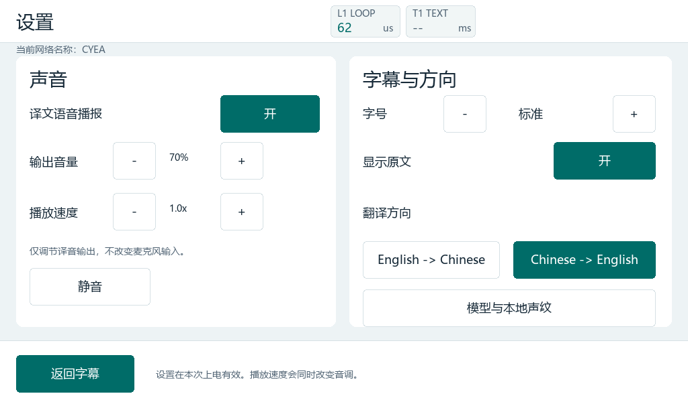

# 板上模型、FPGA 声纹及网络/导出提交验证

本提交包含真实 Qwen Q6 推理、分词器和 UDP 资产/文字协议、百炼 ASR/TTS 与板上翻译编排、FPGA MFCC/CNN、登记与未知拒绝、共用板屏/网页，以及网络名称和完整历史文本导出。固定的公开语料 CNN 权重已提交；大型 Qwen 资产按 model_tools/README.md 获取并校验。

提交副本重新通过 SDK 2018.3 ARM 编译；全部构建输入哈希及 ELF 装载段的地址、大小、内容与此前已加载版本一致。整个 ELF 的非装载部分有差异，两个文件哈希在摘要中分别保留。网络/历史、声纹驱动与界面、登记时拒绝文字任务、语音编排和网页滚轮的原生检查通过。固定 CNN 模型可重新生成与实板一致的 C/header。公开摘要见 [summary.json](summary.json)。工具入口的 Python/旧音频验证路径已改为本机可配置/本克隆路径；发布阶段未重做 FPGA 布局布线或重新烧录。

已加载工程的实板证据包括：CYEA/断开提示、板屏四页与两个网页显示、CPU0/CPU1 运行、USB 屏幕供电、两条受控 Qwen 翻译记录及 CSV/TXT/JSON 完整文本尾部。下面是实际板屏设置页。四页零缺字/裁剪的逐页覆盖来自实际 C 渲染测试；实板摘要另记录当次快照统计，二者分开。

此前 FPGA 2018.3 实现、全部 2048 个 MFCC 和 64 维嵌入的实板逐值核对，以及登记/同声/异声/清除和登记期间关闭上传的检查，见 [声纹专题](../../design/LOCAL_SPEAKER_CNN.md)。这些记录的构建时间与哈希保留原范围。模型耗时、声纹测试集及已知限制见专题；不把模拟状态机检查当成新的实麦、主观听感或身份认证准确率测试。

新克隆先生成字体/显示头及声纹固件数据，再按当前 NOW 的参数构建。模型下载/导出见 [model_tools](../../../model_tools/README.md)。原生检查编译器用 CC 或 --gcc 指定；语音编排用 --cc 指定。测试和工具不需要将 Wi-Fi 密码或云密钥写入仓库。
