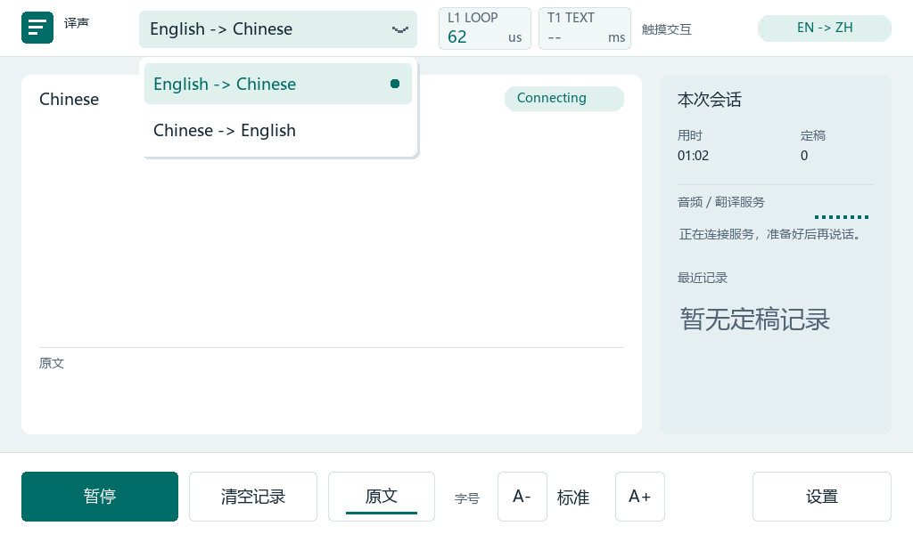

# 板端英中双向语言菜单

2026-10-21，Z7-Nano 7010、AN831 麦克风、ESP8266 1 Mbaud、CYEA、HDMI/USB 触摸。用户要求顶部方向文字变为按钮，只提供 English → Chinese 与 Chinese → English；本阶段完成代码、ARM 构建、暖加载、实际触摸与两方向真实麦克风短验收。

## 实现和边界

交互规则以 [UI_SPEC](../../design/UI_SPEC.md#板端翻译方向切换2026-10-21)为权威来源。菜单复用原 UI 风格；改变方向时更新源/目标语言、清空旧字幕/记录并更新 epoch，保留字号/原文偏好。运行时关闭旧云连接、重建并等待 Ready；暂停中选择保持暂停。原 Opus 采音、UART、可信 TLS 和仅字幕输出不变，保留已有本地回环。

没有新增 PL 逻辑或重构网络重试。ARM APP_DDR 使用 403836 B / 2 MiB，OCM 仍为 57 KiB / 64 KiB；快照为 22912 B / 64 KiB。原播放缓冲仍保留，未声称完成内存裁剪。构建与加载绑定 ELF `46a2c7033f39e3f4c6f1f49b427db1b0c4919374f1b8290ddecd90b74263a124`，见 [build](build.json)、[load](load.json)。

复核发现旧非 ARM 双语构建没有运行期关闭/重连接线，已统一以 `Z7_LANGUAGE_SWITCH` 限定当前 ARM TLS 双语功能，避免出现无实际效果的菜单。独立 ASR 与旧显式构建入口保留；范围见 [review](review.json)。

## 本机验证

- 实际触摸队列、同项收起、空白收起、跨行拖动拒绝、暂停时改变方向、epoch 及旧结果清理通过；非 ARM 构建拒绝未支持的菜单命令。
- 默认译音/仅字幕英语两套各通过 14670 项检查、500 条原有定稿及 4 次运行期方向切换；真实 WebSocket session 编码验证 zh→en / en→zh，旧连接迟到事件不污染新方向，见 [native_text](native_text.json)、[native_audio](native_audio.json)。
- 英译英 11610 项、中文独立 ASR 1640 项、中译英 251 项回归通过；后两者为本次实际运行日志和记录，不使用旧文件冒充，见 [native_enen](native_enen.json)、[native_zhzh](native_zhzh.json)、[native_zhen](native_zhen.json)。
- 原生渲染扩展为 15 类场景、3 档字号，含两方向菜单与关闭态；没有缺字、字形裁切或越界写入。调试工具 6 项、网络客户端 12 项测试通过。汇总与来源指纹见 [validation](validation.json)，当前原生渲染记录见 [host_render](host_render.json)。

模型末尾增加两个 32 位字段，大小 11392 B，快照 11456 B；捕获、原生比较、ctypes 和相关脚本测试同步更新，旧快照必须按其历史 ABI 处理。CPU1 触摸反馈仍 64 B，扩展控件计数使用原 reserved 槽，不越界写 accepted[7]。

## 实际板卡与用户验收

换 ELF 前受控关闭旧云连接、确认网络 idle/error0，再停止匹配 CPU1 并确认 USB DMA Halt；普通 AT 模式及无 TCP 通过后暖加载，没有重配 PL。新程序先在云连接关闭时捕获菜单关闭/展开两帧，均为 614400 像素零差异，见 [frame_closed](frame_closed.json)、[frame_open](frame_open.json)。展开画面是实际板端 DDR 捕获，未上传用户语音文字截图：

随后恢复 CPU1 常驻触摸并隐藏配置运行期凭据。用户先选择 Chinese → English 并说中文，确认“菜单、方向切换和中译英都正常”；再切回 English → Chinese，说英文并点 A+，确认“切回英译中、字幕和字号都正常”，见 [user_acceptance](user_acceptance.json)。两次公开取样分别记录 language=1/0、相应云端定稿，UART/TLS 错误及上传丢页为零，见 [zhen_user](zhen_user.json)、[enzh_user](enzh_user.json)。

本轮实际用户还探索了其他控件；最终反馈包含 33 次点击、31 次被接受（20 次扩展控件、11 次旧控件）、2 次忽略、无丢弃点击，见 [touch_live](touch_live.json)。不把累计握手数解释为受控的一次点击只发生一次握手，也不将这些短测当作双向长期稳定性。

## 新候选收尾故障与恢复

两方向短验收后，收尾取样在相同新 ELF 再次取得 `cloud.live.error=3`，当时 UART/上传丢页和 TLS 错误为零，界面正确进入 Offline，见 [new_server_error](new_server_error.json)。读取已有、跨重连保留的 80 字节公共错误码字段，得到 **UNEXPECTED_ASR_ERROR**，见 [public_error_code](public_error_code.json)和[只读脚本](read_error.py.txt)。没有改业务代码或新增诊断缓冲。

用户补充：曾两次说话无响应，来回切换方向后恢复；但无法把这两次与特定快照一一对应，也不能仅凭错误名判定是云服务根因、输入音频、静默时长或操作时机。官方[错误事件规范](https://www.alibabacloud.com/help/zh/model-studio/live-translator-server-events)定义了 code/message 字段，未在该页列出此码的具体触发条件。本轮不据此增加自动重试或宣称已修复。

之后已重新取到 Ready：network/client 为 4、language=0、字幕和字号保留，见 [recovery_state](recovery_state.json)。手动继续命令这次未被接受，后续确已出现新握手；不将恢复归功于该命令，也不猜测是否有并发用户操作。此时 TLS 错误字段锁存过一次 peer-close（-0x7880）、failure=1；当前连接已就绪不代表本轮始终零错误。下一阶段需在“已就绪后说话”的条件下区分输入/ASR 任务错误及会话恢复。

## 未放行项和旧故障

菜单开发等待期间，上一个 ELF `0661bb…` 的真实麦克风会话出现云端错误 3 与 TLS peer-close（-0x7880），当时 UART/上传丢页仍为零。保存 [previous_fault](previous_fault.json)后受控清空/关闭，确认 [previous_idle](previous_idle.json)才换程序。是否与静默时长有关仍待核实；未添加猜测性的重试，也未宣称菜单修复了它。

[上一阶段固定合成英语的 30 分钟通过](../text-response-20261021/README.md)只属于其固定样本和当时的 ELF；不外推为新菜单、真实麦克风、多次暂停/切换、耳机听感、其他网络或独立启动已通过。未写 Flash/SD 或 ESP 固件，当前仍为 JTAG 易失加载。

[stage](stage.json)保存来源、实际载入身份和公开证据指纹。运行者须先按 [NOW](../../context/NOW.md)确认现有所有权，再按 [RUNBOOK](../../context/RUNBOOK.md#c-云端语音接入)执行；冻结脚本只是方法记录，不构成后续操作授权。公共快照仅保留相关计数，原始本机公开记录另以哈希绑定，未导出密钥、私有种子或音频载荷。
