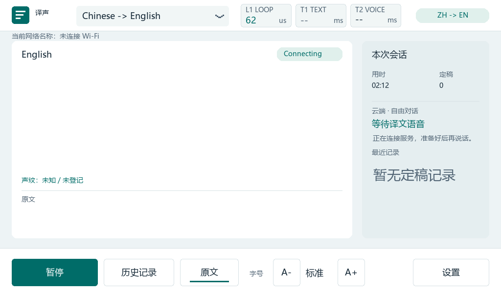

# PR #7 合并后的本机 2026.1 重建与实板检查（2026-10-26）

范围：PR #7（`791da60`）合并为 `e38fbe6` 后，在本机用 Vivado/Vitis 2026.1 重建并 JTAG 易失加载。用户不在现场：没有输入 Wi-Fi/百炼凭据，没有人工看屏或触摸；电脑有线网卡没有到板端 `192.168.1.50` 的链路。决策见 [D24](../../context/DECISIONS.md#d24-合并-pr-7本机以-vivadovitis-20261-重建2026-10-26)，风险见 [R33](../../context/RISKS.md)。

## 构建

| 对象 | 结果 |
| --- | --- |
| 音频组件仿真 | `run_audio_loopback.py simulate`（xsim 2026.1）通过 |
| 声纹 PL 平台 | Vivado 2026.1 综合、实现、DRC 通过；setup/hold 0.040/0.017 ns；LUT 8379/17600、BRAM 38/60、DSP 30/80；USR_ACCESS `0x5a374e35`；位流 SHA256 `97ddda29282ba4189b3a1cfaa04aff3ba850e1a8f01899d27b52a6312a31fd80` |
| 2026.1 适配 | PG160 改为按已安装版本选取（2026.1 为 v4.1）；2026.1 综合后没有 `IOB=TRUE` 的 MII 触发器，相应 `set_property` 改为仅在有单元时执行 |
| ARM 应用 | ARM GCC 13.4.0，`--mode zhen --speech --arm-tls --arm-tls-packets --arm-tls-active-recv --low-latency-playback --touch --remote-display --tinyqwen --speaker-cnn --uart-baud 2000000`，ELF SHA256 `78b7c93eb9863c7cab927bf8796aa5ba16601facdfb64be5a90f6050b6136cc9`，Selftest=false；链接 libm 有 enum 尺寸警告 |
| CPU1 触摸主机 | 构建通过，ELF SHA256 `0929d9572a2e4a63ad9fb27dc635ce95f1cd80ae58d3549bad591d95f8d53cc6` |
| 声纹固件数据 | 由已提交的 `assets/speaker_cnn/model.bin` 重新生成，已跟踪的 `speaker_weights.h` 字节不变 |
| Qwen 资产 | 按固定修订下载并逐文件核对 SHA256；导出的 Q6（401,637,888 字节）与分词器（5,277,796 字节）SHA256 与固件固定值一致 |
| 主机回归 | `test_network_history.py`、`test_speaker_driver.py`、`test_speaker_ui.py`、`test_speaker_llm_guard.py`、`tests/voice_llm/run_unit_tests.py` 全部通过（MinGW GCC 8.1） |

未在本机重做：HLS C/RTL 联合仿真、声纹集成与 48→16 kHz 抽取 xsim（需要 Vivado HLS 2018.3、LibriSpeech 夹具与参考 DLL），沿用队友记录。

## 实板（JTAG，线缆 210241277120）

- `load_tts.py` 完整加载：系统复位、PL 配置、PS 初始化、USB0 端口供电 PP=1、应用启动、CPU1 触摸主机启动。显示报告 98 帧正常、欠载 0、格式错误 0、整帧 614400 像素；WM8731 在线，L1=62 µs，溢出/欠载 0。
- USB0 PORTSC `0x80001805`：端口供电、已连接、已使能，即触摸屏已枚举到端口。触摸本身未做人工验证。
- 声纹加速器（`0x43c40000`）：魔数/版本正确，模型 7076 字装载并通过 PL 内 FNV 校验（`0xaab7fc2f`，ID `0xa3a5ae67`），实时麦克风支路 2 秒内约 37k 样本、232 帧，即 16 kHz、每秒约 100 帧；MFCC 每帧 18,486 周期，与 HLS 联合仿真一致；丢帧、碰撞、溢出均为 0。
- CNN：房间无人说话时不会触发窗口。临时把能量阈值从 2000 改为 0 约 3.5 秒，完成 4 个窗口，每窗口 3,662,554 周期（与 HLS 一致），错误码 0，嵌入非零；随后恢复为 2000。这只验证硬件执行，不涉及说话人识别准确率。
- Qwen 资产：电脑网卡没有到板端的链路，正常的 UDP 4178/4179 上传无法进行。改为 JTAG 把两份资产写入 DDR 固定窗口（模型约 1374 秒、分词器约 18 秒），然后按 `warm_reload_tinyqwen.py` 的方式只重启 CPU0，不重新初始化 DDR：先按归属停止 CPU1，经公开 UI_PAUSE/AT 流程关闭网络，再重启并拉起 CPU1。新固件自己对两份资产全量重算 SHA256 并通过，约 3 分钟后两份均为 ready 并被锁定，板上引擎完成初始化，错误码 0。
- 画面：冻结板上 UI 状态后抓取 DDR 帧缓冲，与本机同一 C 渲染器逐像素比较，614,400 像素差异 0。下图为实际板屏：未连接 Wi-Fi、云端连接中、声纹未登记。

## 未验证

- 板上 Qwen 推理：文字任务只能经网口 UDP 4190/网页 8790 提交，或由云端 ASR 定稿触发；两条路径这次都不可用，所以只验证到资产校验和引擎初始化。
- 云端 ASR/TTS、Wi-Fi 名称显示为实际 SSID、DAC 译音：需要运行期输入凭据。
- 触摸操作、声纹登记/识别、电脑画面（8787）和历史导出：需要人在现场或网口链路。
- 完整日志与探测数据保存在本机 `output/merge_pr7_20261026/`，不随 Git 上传。
